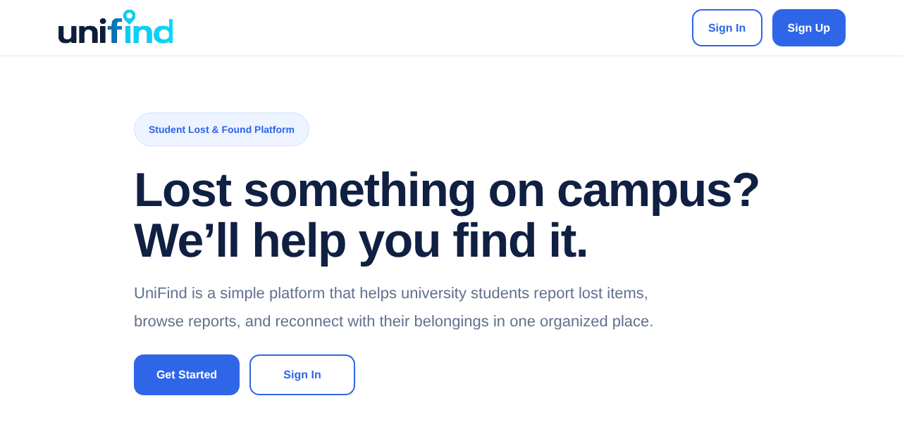
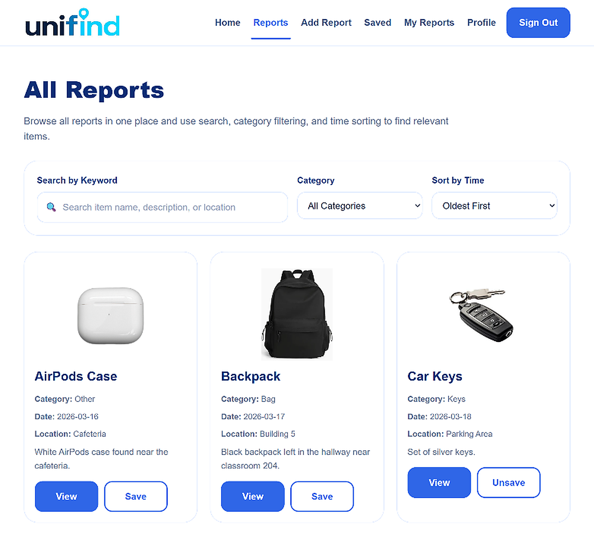
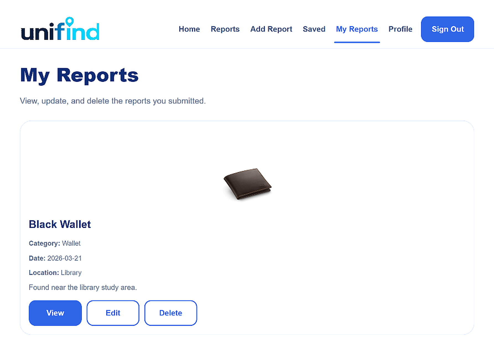

# UniFind 📍

**A full-stack lost-and-found web platform that helps King Saud University students report, find and manage lost items in one place.**


### [▶ Try the live demo](https://leen686.github.io/Unifind/)

One-click access as a student or an admin, with sample data — no sign-up needed.



## The problem

On campus, news about lost belongings is scattered across group chats and social media, so reports are hard to find, compare or follow up on. In the team's survey of 20 students, **80% had lost an item on campus** and **85% said they would use a central website** for lost-and-found reports.

UniFind gives students one organised place to report items, search what has been found, and keep track of their own reports.

## Highlights

- **Full-stack application:** PHP back end, MySQL database, responsive HTML/CSS front end
- **Three-tier architecture:** separate presentation, application and data layers
- **Two roles:** students and administrators, detected automatically at sign-in
- **Prepared statements** for all database queries
- **User-centred process:** requirements from 5 interviews and 20 survey responses, validated by user acceptance testing

## Features

| Students | Administrators |
|---|---|
| Register, sign in and edit their profile | View every report on the platform, with its owner |
| Report an item with a photo, category, date, location and contact number | Search reports by keyword, including the owner's email |
| Search by keyword, filter by category and sort by date | Filter and sort reports |
| Save reports to revisit later | Edit any report |
| Edit or delete their own reports | Delete reports |

### Browse and search reports


### Manage your own reports


## Research and testing

- **Requirements:** 5 student interviews and 20 questionnaire responses
- **Process:** documented requirements, product backlog, architectural design, implementation and testing
- **Testing:** user-story acceptance testing, integration testing and user acceptance testing (UAT)
- **UAT results:** all 5 participants agreed the interface was clear and creating a report was easy; 4 of 5 agreed UniFind met their lost-and-found needs

These results come from a small academic evaluation and are not a large-scale usability study.

📄 [Read the project brief (PDF)](UniFind-Project-Brief-Verified.pdf) — problem, architecture, data model, interface and test results.

## Tech stack

| Layer | Technologies |
|---|---|
| Front end | HTML5, CSS3, JavaScript |
| Back end | PHP with sessions and MySQLi prepared statements |
| Database | MySQL — `users`, `administrators`, `reports`, `categories`, `saved_reports` |

<details>
<summary><b>Project structure</b></summary>

| Files | Purpose |
|---|---|
| `index.php` | Landing page |
| `register.php`, `login.php`, `logout.php` | Registration and sign-in for students and admins |
| `reports.php`, `report-details.php` | Browse, search, filter, sort and view reports |
| `add-report.php`, `edit-report.php`, `delete-report.php`, `my-reports.php` | Create and manage your own reports |
| `saved.php`, `toggle-save.php` | Save and unsave reports |
| `admin-reports.php`, `admin-edit-report.php`, `admin-delete-report.php` | Administration |
| `profile.php` | Profile management |
| `styles.css` | Styles |
| `db.php`, `unifind_db.sql` | Database connection and schema with sample data |
| `images/`, `uploads/` | Sample and uploaded images |
| `docs/` | Live demo (GitHub Pages) and README screenshots |

</details>

<details>
<summary><b>Run it locally</b></summary>

**You need:** PHP with MySQLi, and MySQL (for example XAMPP or MAMP).

1. Clone the repository:
   ```bash
   git clone https://github.com/leen686/Unifind.git
   cd Unifind
   ```
2. Create a database named `unifind_db` and import `unifind_db.sql`.
3. Update the connection settings in `db.php` to match your MySQL server.
4. Make sure the `uploads/` folder is writable.
5. Start a server and open it in your browser:
   ```bash
   php -S localhost:8000
   ```

The SQL file includes sample accounts for local testing only; replace them before any real use.

</details>

<details>
<summary><b>About the live demo</b></summary>

The demo in `docs/` uses the original pages and stylesheet, with the PHP/MySQL back end replaced by sample data stored in the visitor's browser, so it can run on GitHub Pages. It is a preview for portfolio purposes, not an official King Saud University service.

</details>

## Team

Developed by:

- Leen Almutairi
- Jana Aldakheel
- Latifah Alsaif
- Sadeem Alnassar
- Badriyah Aljabri

*Academic software engineering project (IT320) — King Saud University, College of Computer and Information Sciences, 2026*

## Future improvements

Notifications, automatic matching of lost and found items, a mobile app, and support for more universities.
